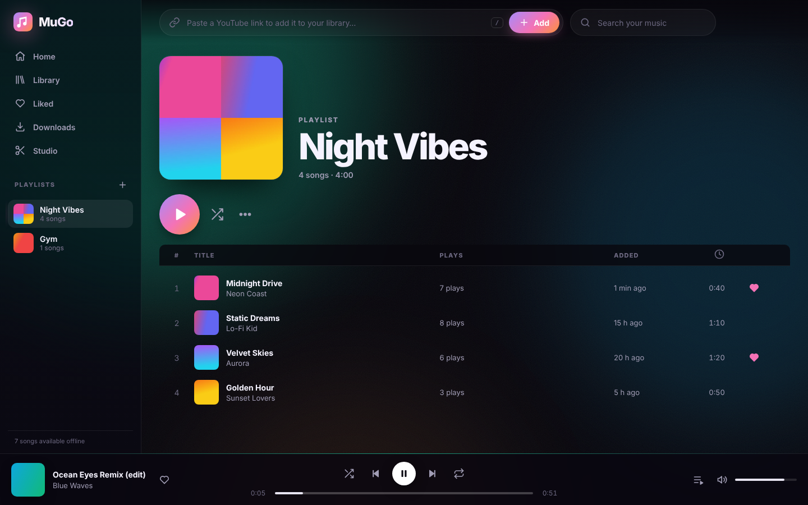
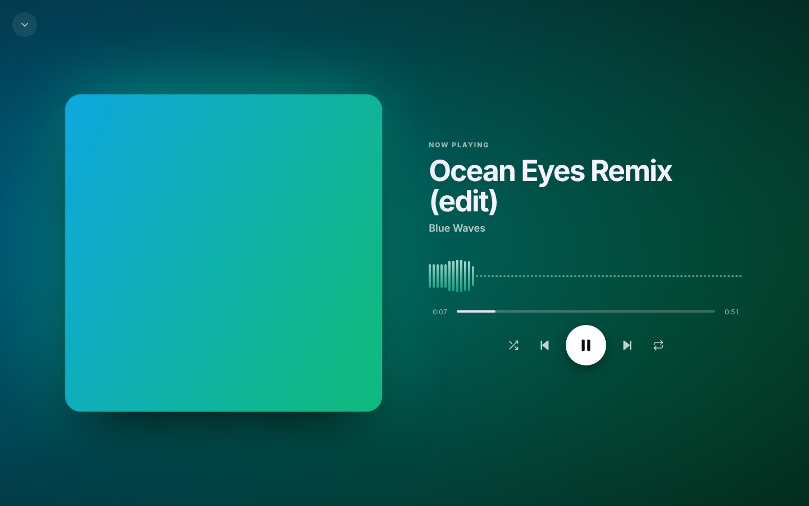

# 🎵 MuGo

**Your own offline music streaming app.** Paste a YouTube link and MuGo adds it to your library, downloads the audio and artwork to your laptop in the background, and plays it from disk, even with no internet.
It also has a **Studio** for trimming songs, cutting out parts and slowing down (or speeding up) sections.


## Features

- **Paste to add.** Use the top bar, press `Ctrl/⌘+V` anywhere on the page, or drag a link onto the window. Videos, Shorts, `music.youtube.com` links and whole playlists all work.
- **Background downloads** with live progress rings. If you close the app mid-download, it resumes the next time you start it.
- **Offline playback.** Audio (`.m4a`) and thumbnails are stored in `~/MuGo`. The whole UI is served locally and needs no CDN or internet.
- **Playlists.** Create, rename, reorder by drag and drop, or drag songs onto a playlist in the sidebar.
- **Player.** Shuffle, repeat (all/one), queue, play next, likes, seek, volume, media keys and lock-screen controls.
- **Now Playing view** with a blurred-art backdrop, a live audio visualizer and artwork that pulses on the beat.
- **Ambient colors.** The app's glow follows the colors of the current song's thumbnail.
- **Studio (music editor):**
  - Drag on the waveform to select a part, then **Cut out**, **Keep only this** (trim) or **change its speed** (0.5×–1.5×).
  - Choose **Natural** (pitch preserved) or **Vinyl** (pitch follows the speed, for the classic "slowed" sound).
  - Set fade in/out, undo/redo, zoom (`Ctrl`+scroll) and preview the edit live before saving.
  - **Save as new song** renders it with ffmpeg into your library. The original is kept.

| Playlist | Now playing | Studio |
|---|---|---|
|  |  |  |

## Setup (one time)

You need **Python 3.9+** and **ffmpeg**:

| OS | Install ffmpeg |
|---|---|
| macOS | `brew install ffmpeg` |
| Windows | `winget install ffmpeg` |
| Linux | `sudo apt install ffmpeg` |

> Recommended: also install [Deno](https://deno.com) (`brew install deno` / `winget install deno`). yt-dlp uses it to handle YouTube's newer protections.

## Run it

```bash
git clone https://github.com/froodyofficial-maker/MuGo.git
cd MuGo
./run.sh          # macOS / Linux
```

On Windows, double-click **`run.bat`**.

The launcher creates a virtual environment, installs and updates the dependencies, then starts the server and **opens MuGo in your browser** at <http://localhost:7777>. Keep the terminal window open while you use it.

Tip: in Chrome or Edge, use **⋮ → Cast, save and share → Install page as app** to give MuGo its own window and dock icon.

### Options

| | |
|---|---|
| `./run.sh --port 8000` | use a different port |
| `./run.sh --no-browser` | don't open a browser tab |
| `MUGO_HOME=/path/to/folder ./run.sh` | store the library somewhere else (default `~/MuGo`) |

## Keyboard shortcuts

| Key | Action |
|---|---|
| `Space` | play / pause (in Studio: preview the edit) |
| `←` `→` | seek 5 s · `Shift` + arrows: previous / next track |
| `↑` `↓` | volume |
| `L` `S` `R` `M` `F` | like · shuffle · repeat · mute · full-screen now playing |
| `/` | focus the "add link" bar |
| Studio: `Del` `K` `Esc` `Ctrl+Z` `+`/`−` | cut selection · keep only selection · clear selection · undo · zoom |

## How it works

```
mugo/server.py      Flask server: library (library.json), yt-dlp download queue, ffmpeg editor renders
mugo/static/        the web app (plain HTML/CSS/JS, no build step)
~/MuGo/             your data: audio/, thumbs/, library.json
```

## Troubleshooting

- **A download fails.** YouTube changes often. Restart with `run.sh`/`run.bat`, which auto-updates yt-dlp, then hit the ↻ retry button on the song.
- **"ffmpeg not found".** Install it (see Setup) and restart.
- For personal use only. Respect YouTube's Terms of Service and artists' copyrights.
