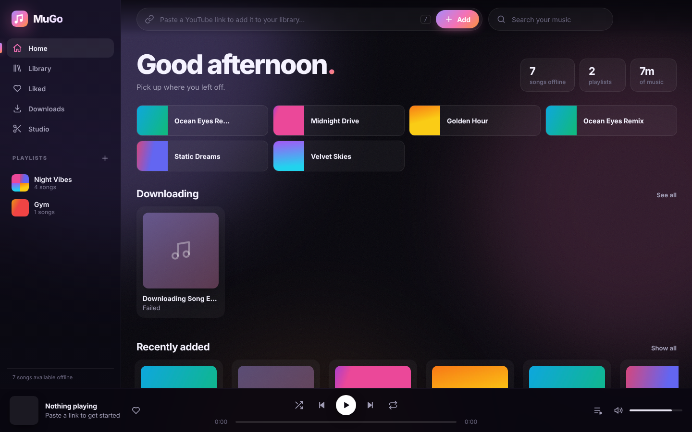
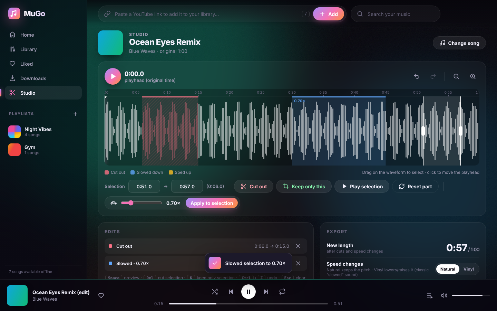

# 🎵 MuGo

**Your own offline music streaming app.** Paste a YouTube link and MuGo adds it to your library, downloads the audio and artwork to your laptop in the background, and plays it from disk, even with no internet.
It also has a **Studio** for trimming songs, cutting out parts and slowing down (or speeding up) sections.



## ⬇ Download (Windows)

### **[Download MuGo-Setup.exe](https://github.com/froodyofficial-maker/MuGo/releases/latest/download/MuGo-Setup.exe)**

Double-click it, and MuGo opens. That's it: ffmpeg and the YouTube downloader are built in, and you don't need Python.

- If Windows says **"Windows protected your PC"**, click **More info → Run anyway**. It shows up because the app isn't code-signed.
- MuGo opens in its own window and keeps running in the **system tray** (bottom-right, near the clock). Right-click the tray icon to **Open** or **Quit**.
- Your music is saved in `%USERPROFILE%\MuGo`. Uninstalling MuGo doesn't delete it.
- The downloader updates itself automatically, so it keeps working when YouTube changes things.

## Features

- **Paste to add.** Use the top bar, press `Ctrl/⌘+V` anywhere on the page, or drag a link onto the window. Videos, Shorts, `music.youtube.com` links and whole playlists all work.
- **Background downloads** with live progress rings. If you close the app mid-download, it resumes the next time you start it.
- **Offline playback.** Audio (`.m4a`) and thumbnails are stored in `~/MuGo`. The whole UI is served locally and needs no CDN or internet.
- **Playlists.** Create, rename, reorder by drag and drop, or drag songs onto a playlist in the sidebar.
- **Player.** Shuffle, repeat (all/one), queue, play next, likes, seek, volume, media keys and lock-screen controls.
- **Now Playing view** with a blurred-art backdrop, a live audio visualizer and artwork that pulses on the beat.
- **Ambient colors.** The app's glow follows the colors of the current song's thumbnail.
- **💥 Aggressive shakes:** in the full-screen Now Playing view, toggle it (or press `X`) and the artwork moves with the music on springs. Kick drums give big punches, snares and hats give smaller hits, and the overall loudness adds a gentle sway, so it bounces and settles naturally instead of jittering.
- **Hide from Home:** right-click a song or a playlist (in the sidebar or on Home) → *Hide from Home*. Songs stay in your Library (with an 👁 tag) and playlists stay in the sidebar, but they no longer appear on the Home page. *Show on Home* undoes it.
- **Custom covers:** right-click a song → *Change cover image…*, or drop an image file onto any song. *Restore original cover* brings the YouTube art back.
- **Studio (music editor):**
  - Drag on the waveform to select a part, then **Cut out**, **Keep only this** (trim) or **change its speed** (0.5×–1.5×).
  - **Deeper** (default) works like slowing a record: pitch and tone drop with the speed, through a high-precision soxr resampler. That's the classic "slowed" sound.
  - **Keep pitch** changes only the tempo, using the studio-grade [Rubber Band](https://breakfastquay.com/rubberband/) time-stretch engine.
  - **Extra depth** shifts the whole song down (or up) by semitones without changing speed. **Warm, heavy tone** boosts the bass and softens the highs.
  - **Convolution reverb** (Room / Hall / Dreamy) with an **amount** slider, for the slowed + reverb sound: from a subtle space up to an echo as loud as the song. It has pre-delay and a low-cut so the song stays clear, and you hear it live in the quick preview. A limiter keeps everything from clipping, and edits are saved as 256 kbps AAC.
  - **🎧 3D / 8D audio (16D binaural engine):** the music plays at a moving point around you inside a virtual room, the way "16D" tracks are made. It uses a binaural head model, so you get real time and tone differences between your ears, front/back and height cues, and the far ear is softened by your head. Echoes from all six walls/floor/ceiling each arrive from their own direction, plus the room's diffuse tail, and the bass stays centred.
    - **Movement:** circle, figure 8, ping-pong, spiral or wander, clockwise or counter-clockwise
    - **Speed, distance, breathing** (drifting closer and further away), **height** and **stereo width**
    - **Room:** none, small room, empty room, big empty hall or cathedral, plus a room-amount slider
    - **Keep bass centred** on or off, and a **live radar** showing where the music is
    - Apply it to the whole song or only to parts marked with **8D this part**. The live preview uses the same engine as the saved file. **Classic 8D** (simple left/right circling) is still available.
  - **Hi-Fi preview** renders the edit with the real engine so you hear exactly what will be saved. The quick preview is instant but only approximates the sound.
  - Set fade in/out, undo/redo, zoom (`Ctrl`+scroll) and preview the edit live before saving.
  - **Save as new song** renders it with ffmpeg into your library. The original is kept.

| Playlist | Now playing | Studio |
|---|---|---|
|  |  |  |

## Run from source (macOS / Linux / developers)

### Setup (one time)

You need **Python 3.9+** and **ffmpeg**:

| OS | Install ffmpeg |
|---|---|
| macOS | `brew install ffmpeg` |
| Windows | `winget install ffmpeg` |
| Linux | `sudo apt install ffmpeg` |

> Recommended: also install [Deno](https://deno.com) (`brew install deno` / `winget install deno`). yt-dlp uses it to handle YouTube's newer protections.

### Run it

```bash
git clone https://github.com/froodyofficial-maker/MuGo.git
cd MuGo
./run.sh          # macOS / Linux
```

On Windows, double-click **`run.bat`**.

The launcher creates a virtual environment, installs and updates the dependencies, then starts the server and **opens MuGo in your browser** at <http://localhost:7777>. Keep the terminal window open while you use it.

Tip: in Chrome or Edge, use **⋮ → Cast, save and share → Install page as app** to give MuGo its own window and dock icon.

#### Options

| | |
|---|---|
| `./run.sh --port 8000` | use a different port |
| `./run.sh --no-browser` | don't open a browser tab |
| `MUGO_HOME=/path/to/folder ./run.sh` | store the library somewhere else (default `~/MuGo`) |

## Keyboard shortcuts

| Key | Action |
|---|---|
| `Space` | play / pause (in Studio: preview the edit) |
| `←` `→` | seek 5 s · `Shift` + arrows: previous / next track |
| `↑` `↓` | volume |
| `L` `S` `R` `M` `F` | like · shuffle · repeat · mute · full-screen now playing |
| `X` | aggressive shakes (in full-screen Now Playing) |
| `/` | focus the "add link" bar |
| Studio: `Del` `K` `Esc` `Ctrl+Z` `+`/`−` | cut selection · keep only selection · clear selection · undo · zoom |

## How it works

```
mugo/server.py      Flask server: library (library.json), yt-dlp download queue, ffmpeg editor renders
mugo/static/        the web app (plain HTML/CSS/JS, no build step)
packaging/          Windows build: PyInstaller + Inno Setup (built by .github/workflows/build-windows.yml)
~/MuGo/             your data: audio/, thumbs/, library.json
```

## Troubleshooting

- **A download fails.** YouTube changes often. Quit MuGo from the tray and open it again (it fetches the newest downloader on start), then hit the ↻ retry button on the song. From source, `run.sh`/`run.bat` updates it.
- **Something else is wrong (Windows app).** The log is at `%USERPROFILE%\MuGo\mugo.log`.
- **"ffmpeg not found".** Install it (see Setup) and restart.
- For personal use only. Respect YouTube's Terms of Service and artists' copyrights.
